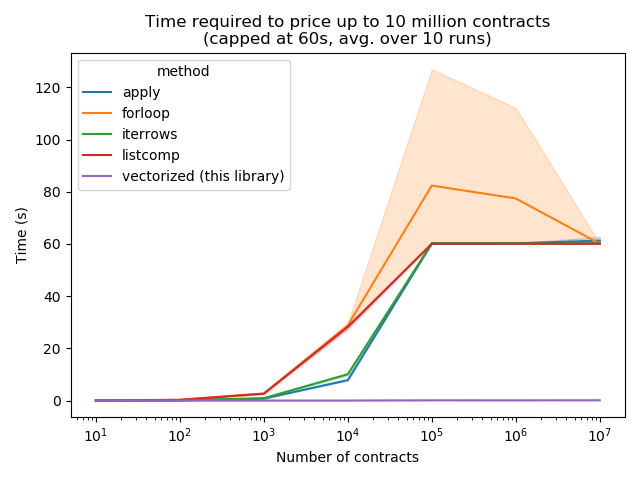

# py_vollib_vectorized

## Introduction

The `py_vollib_vectorized` package makes pricing thousands of option contracts and calculating greeks fast and effortless.
It is built on top of the `py_vollib` library.
Upon import, it will automatically patch the corresponding `py_vollib` functions so as to support vectorization.
Inputs can then be passed as floats, tuples, lists, `numpy.array`, or `pandas.Series`.
Automatic broadcasting is performed on the inputs.

On top of vectorization, modifications to py_vollib include additional `numba` speedups; as such, `numba` is required.
These speedups make `py_vollib_vectorized` the fastest library for pricing option contracts.

See the [documentation](https://py-vollib-vectorized.readthedocs.io/en/latest) for more details.

Don't run `pip install py_vollib_vectorized`! that is install https://github.com/marcdemers/py_vollib_vectorized

## Installation

    pip install git+https://github.com/traderlife8/py_vollib_vectorized.git

## Use in code

    try:
        import py_vollib_vectorized as pvv
    except ImportError:
        import subprocess, sys
        subprocess.check_call(
            [sys.executable, '-m', 'pip', 'install', 'git+https://github.com/traderlife8/py_vollib_vectorized.git']
        )
        import py_vollib_vectorized as pvv

## Requirements

* Written for Python 3.5+
* Requires py_vollib, numba, numpy, pandas, scipy

## Code samples

The library can be used in two ways.
Upon import, it monkey-patches (i.e. replaces) the corresponding functions in `py_vollib`.

As a more versatile alternative, users that would prefer to work with a dedicated option pricing API can make use of the utility functions provided by the library.

#### Patching `py_vollib`

```python
# The usual py_vollib syntax

import numpy as np
import pandas as pd

import py_vollib.black_scholes
flag = 'c'  # 'c' for call, 'p' for put
S = 100  # Underlying asset price
K = 90  # Strike
t = 0.5  # (Annualized) time-to-expiration
r = 0.01  # Interest free rate
iv = 0.2  # Implied Volatility

option_price = py_vollib.black_scholes.black_scholes(flag, S, K, t, r, iv)  # 12.111581435

# This library keeps the same syntax, but you can pass as input any iterable of values.
# This includes list, tuple, numpy.array, pd.Series, pd.DataFrame (with only a single column).
# Note that you must pass a value for each contract as *no broadcasting* is done on the inputs.


# Patch the original py_vollib library by importing py_vollib_vectorized
import py_vollib_vectorized  # The same functions now accept vectors as input!

# Note that the input arguments are broadcasted.
# You can specify ints, floats, tuples, lists, numpy arrays or Series.

flag = ['c', 'p']  # 'c' for call, 'p' for put
S = (100, 100)  # Underlying asset prices
K = [90]  # Strikes
t = pd.Series([0.5, 0.6])  # (Annualized) times-to-expiration
r = np.array([0.01])  # Interest free rates
iv = 0.2  # Implied Volatilities

option_price = py_vollib.black_scholes.black_scholes(flag, S, K, t, r, iv, return_as='array')  
# array([12.11158143,  2.02418536])
```

#### Utility functions
We also define other utility functions to get all contract prices, implied volatilities, and greeks in a single call.

```python
import pandas as pd
from py_vollib_vectorized import price_dataframe, get_all_greeks

# Using the data above, we can calculate all contracts greeks in a single call
greeks = get_all_greeks(flag, S, K, t, r, iv, model='black_scholes', return_as='dict')

#   {'delta': array([ 0.80263679, -0.21293214]),
#    'gamma': array([0.0196385, 0.01875498]),
#    'theta': array([-0.01263557, -0.00964498]),
#    'rho': array([0.34073321, -0.13994668]),
#    'vega': array([0.19626478, 0.22493816])}

# We can also price a dataframe easily by specifying a dataframe and the corresponding columns

df = pd.DataFrame()
df['Flag'] = ['c', 'p']
df['S'] = 95
df['K'] = [100, 90]
df['T'] = 0.2
df['R'] = 0.2
df['IV'] = 0.2
result = price_dataframe(df, flag_col='Flag', underlying_price_col='S', strike_col='K', annualized_tte_col='T',
                     riskfree_rate_col='R', sigma_col='IV', model='black_scholes', inplace=False)
#   Price       delta       gamma       theta       rho        vega
#   2.895588    0.467506    0.046795    -0.045900   0.083035   0.168926
#   0.611094    -0.136447   0.025739    -0.005335   -0.027151  0.092838

```

See the [documentation](https//py-vollib-vectorized.readthedocs.io/en/latest) for more details.

## Benchmarking

Compared to looping through contracts or to using built-in pandas functionality, this library is very memory efficient and scales fast and well to a large number of contracts.



## Acknowledgements

This library optimizes the `py_vollib` codebase, itself built upon Peter Jaeckel's *Let's be rational* methodology.

---

## Fork Modifications (traderlife8 fork)

This fork adds several bug fixes and performance optimizations over the original upstream. All modifications are listed chronologically with commit descriptions.

### Commit History Since Fork

| # | Date | Commit | Description |
|---|------|--------|-------------|
| 1 | 2026-06-27 | `b30af5e` | fix numpy arrays not being propagated |
| 2 | 2026-06-27 | `fa74ba2` | fix too many args |
| 3 | 2026-06-27 | `ff17f8c` | fix: Black model numerical Greeks and missing deflater |
| 4 | 2026-06-27 | `57a36bc` | 进一步提速 (further speedup) |
| 5 | 2026-06-29 | `88f503e` | Change installation command for py_vollib_vectorized |
| 6 | 2026-06-29 | `19f5af8` | Update README.md |
| 7 | 2026-08-07 | `d1ca4df` | 修改Black-76模型签名,使greeks.py可统一传递b参数 |
| 8 | 2026-08-17 | `8a9fc0b` | 修复错误 (bug fixes) |
| 9 | 2026-08-17 | `a98e1f9` | 预处理层提速 (preprocessing speedup) |
| 10 | 2026-08-17 | `04e70fd` | Update setup.py |

### Detailed Changes

#### 1. Black Model Greeks: Missing Deflater (`ff17f8c`)

**Bug**: The original `_numerical_greeks.py` used `black()` (undiscounted) for Black model delta/theta/vega/gamma differentials, which **lacked the `exp(-r*t)` deflater**. This caused incorrect Greeks when `r != 0`.

**Fix**: 
- Added `discounted_black()` function in `_model_calls.py` (wraps `black() * exp(-r*t)` to match py_vollib's `black()`)
- Switched all Black model numerical Greeks to use `discounted_black()` instead of raw `black()`
- Exception: `numerical_rho_black` manually diffs the deflater (more efficient: `black()` called once, then deflater diffed)

#### 2. Black-76 Model Signature Unification (`d1ca4df`, `8a9fc0b`)

**Original upstream bug**: `get_all_greeks()` with `model='black'` called `numerical_delta_black_scholes(...)` (the BS variant!) instead of `numerical_delta_black(...)`. This was a copy-paste error: the original code set `b = r - r` (=0) and passed it to the BS numerical functions, which still worked because `b=0` matches Black model, but the function names were misleading.

**Fix**:
- Added `bs` parameter to all `numerical_*_black` functions for signature parity with BS/BSM variants
- Refactored `get_all_greeks()` to extract `_all_greeks_core()` - a shared core that dispatches to the correct numerical functions per model
- `get_all_greeks()` now calls `_all_greeks_core()` for clean dispatch

#### 3. Preprocessing Speedup (`57a36bc`, `a98e1f9`)

**Changes in `data_format.py`**:
- `_preprocess_flags`: Replaced list comprehension `[binary_flag[f] for f in flags]` with vectorized `np.where()` chain. ~15-20ms savings for 100k contracts
- `_maybe_format_data`: Added `copy=False` to `astype()` to avoid unnecessary array copy when dtype already matches
- `maybe_format_data_and_broadcast`: Added fast path — skip `broadcast_arrays` when all inputs are already equal length, avoiding one extra copy
- `_check_below_and_above_intrinsic` / `_check_minus_above_float`: Always compute violation indices regardless of `on_error` mode, ensuring NaN output consistency across warn/ignore/raise

**Changes in `_numerical_greeks.py` and `_model_calls.py`**:
- Replaced `list.append()` accumulation with `np.empty(n)` pre-allocation + index assignment throughout. This is critical for numba JIT: `np.empty` + indexed assignment > `list.append` for both JIT compilation and runtime

**Changes in `api.py`**:
- `price_dataframe()`: Pass `return_as="numpy"` to all pricing/IV intermediate calls, skipping wasteful DataFrame construction
- `_all_greeks_core()`: New function bypasses `get_all_greeks()`'s redundant preprocessing (broadcast + validation already done by caller)

#### 4. IV Resolution Fix (`8a9fc0b`)

- `_iv_models.py`: Added `T <= 0` guard in `implied_volatility_from_a_transformed_rational_guess_with_limited_iterations` — returns NaN for expired/negative-TTE contracts instead of crashing from division by zero
- `_iv_models.py`: Fixed `_unchecked_normalised_implied_volatility_from_a_transformed_rational_guess_with_limited_iterations` — `f` variable could be undefined when `d2_f_upper_map_h_d_beta2` overflowed; added sentinel `f = -1.0` initialization

#### 5. Setup & Git Config

- `setup.py`: Replaced `distutils.core.setup` with `setuptools.setup` (distutils removed in Python 3.12+)
- `.gitignore`: Added `/.codebuddy` and `*.code-workspace`

---

## pvv vs py_vollib: Deviation Analysis

### Unit Convention Notes

- **vega**: Both libraries output per 1% sigma change (py_vollib analytical `*0.01`, pvv numerical uses `sigma +/- 0.01` step). **Consistent.**
- **theta**: Both output per calendar day. py_vollib analytical uses `-dP/dt / 365`; pvv numerical uses `P(t-1/365) - P(t)` (forward difference, not `/365`). **Near-equivalent but not exactly equal** — short-tenor (T<7d) differences up to ~3.8% rel.
- **Discount factor**: All pvv Greeks include `exp(-r*t)` internally (from the pricing function); py_vollib analytical Greeks also include it. **Consistent.**

### Full Comparison Table

| # | Item | py_vollib Behavior | pvv Behavior | Difference | Should Align? |
|---|------|-------------------|-------------|-----------|---------------|
| 1 | **rho (BSM model)** | `numerical_rho`: diffs `r` and `b` simultaneously (`b = r-q` moves with `r`, `q` fixed) | `numerical_rho_black_scholes_merton`: diffs only `r`; `q` implicitly moves inversely with `r` | **Substantive bug**: Economically, `q` (dividend yield) should not change with `r`. pvv's approach is semantically wrong | **YES** — should fix to match py_vollib |
| 2 | **theta (all models)** | Analytical: `-dP/dt / 365` (exact partial derivative) | Numerical: `P(t-1/365) - P(t)` (forward difference, includes 2nd-order term) | **Near-equivalent**: Short-tenor divergence up to ~3.8% rel | No — pvv's numerical approach is a design choice for JIT vectorization |
| 3 | **rho (Black model)** | analytical: `-t * V * 0.01` (uses discounted price `V`) | `numerical_rho_black`: manual deflater diff on undiscounted price: `undiscounted * (exp(-(r+0.01)*t) - exp(-(r-0.01)*t)) / 2` | Implementation differs, result is mathematically equivalent (1st order = `-t*V*0.01`) | No — no practical impact |
| 4 | **rho (BS model)** | `numerical_rho` diffs `r` and `b=r` simultaneously | `numerical_rho_black_scholes`: diffs `r` directly; `F = S/exp(-rt)` auto-updates with `r` | **Effectively equivalent**: BS model `b=r` is an identity, so both approaches converge | No — no practical impact |
| 5 | **gamma (BS model)** | analytical: `pdf(d1) / (S * sigma * sqrt(t))` — no `exp(-rt)` | numerical: `(P(S+dS) - 2P(S) + P(S-dS)) / dS^2` — includes `exp(-rt)` from pricing | **Effectively equivalent**: Chain rule via `F = S/exp(-rt)` cancels `exp(-rt)` in the 2nd derivative | No — no practical impact |
| 6 | **Flag encoding** | String `'c'` / `'p'` | Numeric `+1` / `-1` (internal `_preprocess_flags` conversion) | Interface difference only | No — vectorization requires numeric flags |
| 7 | **IV error handling** | Raises `PriceIsAboveMaximum` / `PriceIsBelowIntrinsic` | Returns `NaN` + optional warn | Interface difference: exception vs NaN | No — NaN is vectorization-friendly |
| 8 | **Pricing: Black model deflater** | `black(flag, F, K, t, r, sigma)` returns discounted price | `vectorized_black`: `_black_vectorized_call()` returns undiscounted, then `* exp(-r*t)` applied | Fixed in this fork | Already fixed |

### Verdict

Of all deviations, only **#1 (BSM rho)** is a genuine bug that should be fixed. The rest are either:
- Design choices for vectorization (numerical approach, NaN handling, numeric flags)
- Mathematically equivalent implementations (BS rho, BS gamma, Black rho)
- Known near-equivalence (theta short-tenor divergence)

**BSM rho bug**: When computing rho for the Black-Scholes-Merton model (with dividend yield `q`), pvv's `numerical_rho_black_scholes_merton` fixes `r-b = q` during the `r +/- 0.01` differential, effectively making `q` move inversely with `r`. The correct approach (as in py_vollib's `helpers/numerical_greeks.py`) is to fix `q` and let `b = r - q` change with `r`.

This bug only affects BSM model usage (e.g., equity options with dividends). Black (commodity futures options) and BS (index options, q=0) models are unaffected.