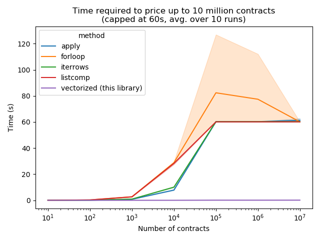

# py_vollib_vectorized

## 简介

`py_vollib_vectorized` 在 `py_vollib` 基础上实现向量化，批量定价数千份期权合约并计算 Greeks，快速高效。
导入后自动 patch 对应的 `py_vollib` 函数，使之支持向量化输入。
输入支持 float、tuple、list、`numpy.array` 或 `pandas.Series`，自动广播对齐。

此外，对 `py_vollib` 的修改还包括 `numba` 加速，因此需要安装 `numba`。
这些加速使 `py_vollib_vectorized` 成为定价期权合约最快的库。

详见[文档](https://py-vollib-vectorized.readthedocs.io/en/latest)（英文）。

**不要运行 `pip install py_vollib_vectorized`**！那是安装 https://github.com/marcdemers/py_vollib_vectorized（上游原版）。

## 安装

    pip install git+https://github.com/traderlife8/py_vollib_vectorized.git

## 代码中使用

    try:
        import py_vollib_vectorized as pvv
    except ImportError:
        import subprocess, sys
        subprocess.check_call(
            [sys.executable, '-m', 'pip', 'install', 'git+https://github.com/traderlife8/py_vollib_vectorized.git']
        )
        import py_vollib_vectorized as pvv

## 依赖

* Python 3.5+
* py_vollib, numba, numpy, pandas, scipy

## 代码示例

库有两种使用方式。导入后自动 monkey-patch（替换）`py_vollib` 中对应函数。
更灵活的方式是直接使用库提供的工具函数。

#### 方式一：Patch `py_vollib`

```python
# 标准 py_vollib 语法

import numpy as np
import pandas as pd

import py_vollib.black_scholes
flag = 'c'  # 'c'=看涨, 'p'=看跌
S = 100  # 标的资产价格
K = 90  # 行权价
t = 0.5  # 年化到期时间
r = 0.01  # 无风险利率
iv = 0.2  # 隐含波动率

option_price = py_vollib.black_scholes.black_scholes(flag, S, K, t, r, iv)  # 12.111581435

# 导入 py_vollib_vectorized 后, 同一函数即可接受向量输入
import py_vollib_vectorized

flag = ['c', 'p']  # 'c'=看涨, 'p'=看跌
S = (100, 100)  # 标的价格
K = [90]  # 行权价
t = pd.Series([0.5, 0.6])  # 到期时间
r = np.array([0.01])  # 利率
iv = 0.2  # 波动率

option_price = py_vollib.black_scholes.black_scholes(flag, S, K, t, r, iv, return_as='array')
# array([12.11158143,  2.02418536])
```

#### 方式二：工具函数

```python
import pandas as pd
from py_vollib_vectorized import price_dataframe, get_all_greeks

# 一次调用计算所有合约的 Greeks
greeks = get_all_greeks(flag, S, K, t, r, iv, model='black_scholes', return_as='dict')

#   {'delta': array([ 0.80263679, -0.21293214]),
#    'gamma': array([0.0196385, 0.01875498]),
#    'theta': array([-0.01263557, -0.00964498]),
#    'rho': array([0.34073321, -0.13994668]),
#    'vega': array([0.19626478, 0.22493816])}

# 直接传入 DataFrame 计算
df = pd.DataFrame()
df['Flag'] = ['c', 'p']
df['S'] = 95
df['K'] = [100, 90]
df['T'] = 0.2
df['R'] = 0.2
df['IV'] = 0.2
result = price_dataframe(df, flag_col='Flag', underlying_price_col='S', strike_col='K',
                         annualized_tte_col='T', riskfree_rate_col='R', sigma_col='IV',
                         model='black_scholes', inplace=False)
#   Price       delta       gamma       theta       rho        vega
#   2.895588    0.467506    0.046795    -0.045900   0.083035   0.168926
#   0.611094    -0.136447   0.025739    -0.005335   -0.027151  0.092838
```

详见[文档](https://py-vollib-vectorized.readthedocs.io/en/latest)（英文）。

## 基准测试

相比逐合约循环或 pandas 内置功能，此库内存效率高，大量合约场景下扩展性优秀。



## 致谢

此库优化了 `py_vollib` 代码库，后者基于 Peter Jaeckel 的 *Let's be rational* 方法。

---

## Fork 修改记录（traderlife8 分支）

此 fork 在上游原版基础上进行了多项 bug 修复和性能优化。

### 提交历史（按时间顺序）

| # | 日期 | Commit | 描述 |
|---|------|--------|------|
| 1 | 2026-06-27 | `b30af5e` | fix numpy arrays not being propagated |
| 2 | 2026-06-27 | `fa74ba2` | fix too many args |
| 3 | 2026-06-27 | `ff17f8c` | 修复 Black 模型数值 Greeks 缺少贴现因子 |
| 4 | 2026-06-27 | `57a36bc` | 进一步提速 |
| 5 | 2026-06-29 | `88f503e` | 修改安装命令 |
| 6 | 2026-06-29 | `19f5af8` | 更新 README |
| 7 | 2026-08-07 | `d1ca4df` | 修改 Black-76 模型签名，使 greeks.py 可统一传递 b 参数 |
| 8 | 2026-08-17 | `8a9fc0b` | 修复错误 |
| 9 | 2026-08-17 | `a98e1f9` | 预处理层提速 |
| 10 | 2026-08-17 | `04e70fd` | 更新 setup.py |

### 修改详情

#### 1. Black 模型 Greeks 缺少贴现因子（`ff17f8c`）

**Bug**：原版 `_numerical_greeks.py` 中 Black 模型的 delta/theta/vega/gamma 数值差分使用了 `black()`（未折现版本），**缺少 `exp(-r*t)` 贴现因子**。当 `r != 0` 时 Greeks 不正确。

**修复**：
- 在 `_model_calls.py` 中新增 `discounted_black()` 函数（`black() * exp(-r*t)`，与 py_vollib 的 `black()` 对齐）
- 所有 Black 模型数值 Greeks 改用 `discounted_black()` 替代原始 `black()`
- 例外：`numerical_rho_black` 手动差分贴现因子（更高效——`black()` 只算一次，然后差分 deflater）

#### 2. Black-76 模型签名统一（`d1ca4df`, `8a9fc0b`）

**上游原版 bug**：`get_all_greeks()` 在 `model='black'` 时调用了 `numerical_delta_black_scholes(...)`（BS 版本！）而非 `numerical_delta_black(...)`。这是典型的复制粘贴错误——原代码将 `b = r - r` (=0) 传给 BS 数值函数，因为 `b=0` 恰好匹配 Black 模型而表面"工作"，但函数名严重误导。

**修复**：
- 为所有 `numerical_*_black` 函数增加 `bs` 参数，与 BS/BSM 变体签名一致
- 重构 `get_all_greeks()`，提取 `_all_greeks_core()` 共享核心，按模型正确分发
- `get_all_greeks()` 改调 `_all_greeks_core()` 实现干净分发

#### 3. 预处理层提速（`57a36bc`, `a98e1f9`）

**`data_format.py` 改动**：
- `_preprocess_flags`：列表推导式 `[binary_flag[f] for f in flags]` 改为向量化 `np.where()` 链，10 万合约节省约 15-20ms
- `_maybe_format_data`：`astype()` 增加 `copy=False`，dtype 已匹配时免去不必要的副本
- `maybe_format_data_and_broadcast`：增加等长快速路径——所有输入已等长时跳过 `broadcast_arrays`，避免一次额外复制
- `_check_below_and_above_intrinsic` / `_check_minus_above_float`：无论 `on_error` 模式，始终计算越界索引，确保 warn/ignore/raise 三种模式下 NaN 输出一致

**`_numerical_greeks.py` 和 `_model_calls.py` 改动**：
- 全量替换 `list.append()` 累积为 `np.empty(n)` 预分配 + 索引赋值。这对 numba JIT 至关重要——`np.empty` + 索引赋值在 JIT 编译和执行时都优于 `list.append`

**`api.py` 改动**：
- `price_dataframe()`：定价/IV 中间调用均传 `return_as="numpy"`，跳过不必要的 DataFrame 构造
- `_all_greeks_core()`：新函数绕过 `get_all_greeks()` 的冗余预处理（广播和校验已被调用方完成）

#### 4. IV 反解修复（`8a9fc0b`）

- `_iv_models.py`：在 `implied_volatility_from_a_transformed_rational_guess_with_limited_iterations` 中增加 `T <= 0` 守卫——到期/负到期合约返回 NaN，而非除零崩溃
- `_iv_models.py`：修复 `_unchecked_normalised_implied_volatility_from_a_transformed_rational_guess_with_limited_iterations`——当 `d2_f_upper_map_h_d_beta2` 溢出时 `f` 变量未定义；增加哨兵 `f = -1.0` 初始化

#### 5. 安装与配置

- `setup.py`：`distutils.core.setup` 替换为 `setuptools.setup`（distutils 在 Python 3.12+ 已移除）
- `.gitignore`：增加 `/.codebuddy` 和 `*.code-workspace`

---

## pvv 与 py_vollib 差异分析

### 单位约定说明

- **vega**：两个库都按每 1% sigma 变化输出（py_vollib 解析式 `*0.01`，pvv 数值差分步长 `sigma +/- 0.01`）。**一致。**
- **theta**：都按每日历日输出。py_vollib 解析式用 `-dP/dt / 365`；pvv 数值用 `P(t-1/365) - P(t)`（前向差分，未除 365）。**近似等价但不完全相等**——短期限（T<7天）差异可达 ~3.8% rel。
- **贴现因子**：pvv 所有 Greeks 内部都包含 `exp(-r*t)`（来自定价函数）；py_vollib 解析式 Greeks 也包含。**一致。**

### 完整对比表

| # | 项目 | py_vollib 行为 | pvv 行为 | 差异性质 | 应一致？ |
|---|------|---------------|----------|---------|---------|
| 1 | **BSM 模型 rho** | `numerical_rho` 同时差分 `r` 和 `b`（`b=r-q` 随 `r` 变，`q` 不变） | `numerical_rho_black_scholes_merton` 只差分 `r`；`q` 隐式随 `r` 反向变 | **实质 bug**：经济学上 q（股息率）不应随 r 变化。pvv 的做法语义错误 | **YES** — 应修复与 py_vollib 一致 |
| 2 | **theta（所有模型）** | 解析式：`-dP/dt / 365`（精确偏导） | 数值：`P(t-1/365) - P(t)`（前向差分，含二阶项） | **近似等价**：短期限差异 ~3.8% rel | 否 — pvv 数值路线是 JIT 向量化的设计选择 |
| 3 | **Black 模型 rho** | 解析式：`-t * V * 0.01`（使用折现价 V） | `numerical_rho_black`：对未折现价手动差分 deflater | 实现路径不同，结果数学等价（一阶项 = `-t*V*0.01`） | 否 — 无实际影响 |
| 4 | **BS 模型 rho** | `numerical_rho` 同时差分 `r` 和 `b=r` | `numerical_rho_black_scholes` 直接差分 `r`；`F=S/exp(-rt)` 自动随 r 变 | **实质等价**：BS 模型 `b=r` 是恒等关系 | 否 — 无实际影响 |
| 5 | **BS 模型 gamma** | 解析式：`pdf(d1) / (S * sigma * sqrt(t))` — 不含 `exp(-rt)` | 数值：`(P(S+dS) - 2P(S) + P(S-dS)) / dS^2` — 含 `exp(-rt)` | **实质等价**：链式法则经 `F=S/exp(-rt)` 约掉了 `exp(-rt)` | 否 — 无实际影响 |
| 6 | **Flag 编码** | 字符串 `'c'` / `'p'` | 数值 `+1` / `-1`（内部 `_preprocess_flags` 转换） | 接口差异 | 否 — 向量化需要数值 flag |
| 7 | **IV 异常处理** | 抛异常 `PriceIsAboveMaximum` / `PriceIsBelowIntrinsic` | 返回 `NaN` + 可选 warn | 接口差异：异常 vs NaN | 否 — NaN 更适合批量计算 |
| 8 | **Black 定价折现** | `black()` 返回折现价 | `vectorized_black` 原版：`_black_vectorized_call()` 返回未折现价，缺 `* exp(-r*t)` | 本 fork 已修复 | 已修复 |

### 结论

所有差异中，只有 **#1（BSM rho）** 是真正的 bug 需要修复。其余均为：
- 向量化的设计选择（数值法、NaN 处理、数值 flag）
- 数学等价的实现（BS rho、BS gamma、Black rho）
- 已知的近似等价（theta 短期限差异）

**BSM rho bug**：计算 Black-Scholes-Merton 模型（含股息率 q）的 rho 时，pvv 的 `numerical_rho_black_scholes_merton` 在 `r +/- 0.01` 差分过程中固定了 `r-b = q`，本质上让 q 随 r 反向变动。正确做法（如 py_vollib `helpers/numerical_greeks.py` 所示）是固定 q，让 `b = r - q` 随 r 变化。

此 bug 仅影响 BSM 模型使用场景（如带股息的个股期权）。Black 模型（商品期货期权）和 BS 模型（股指期权，q=0）不受影响。